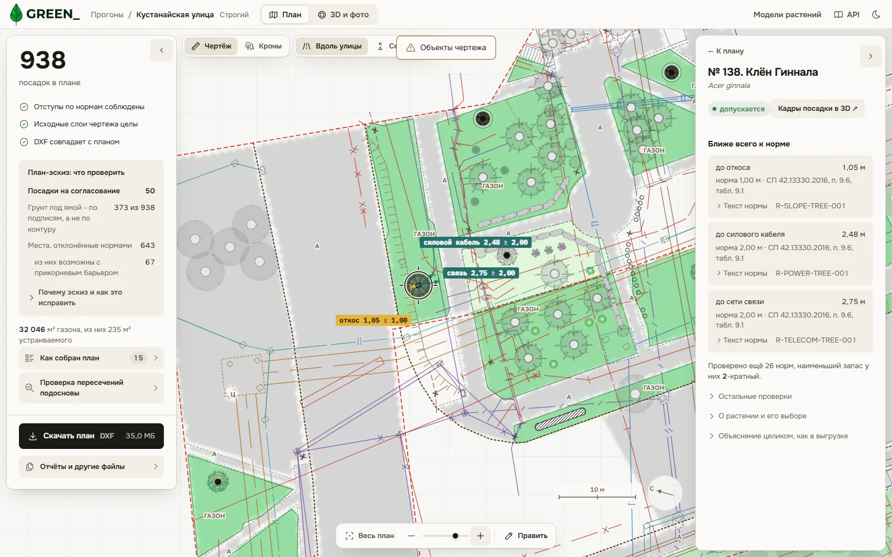
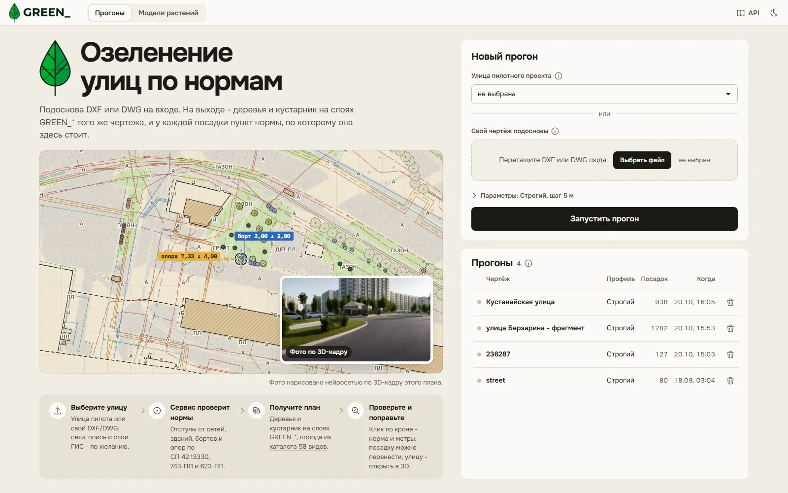
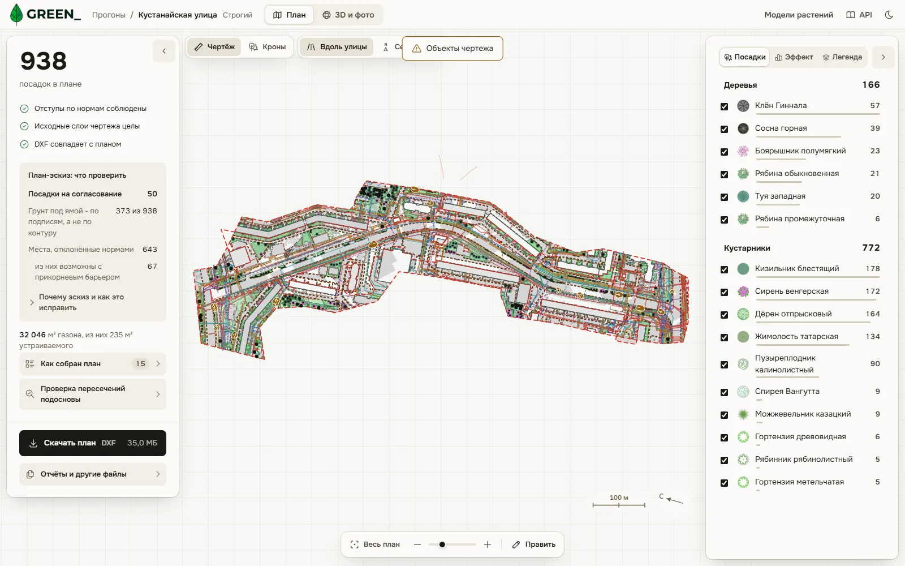
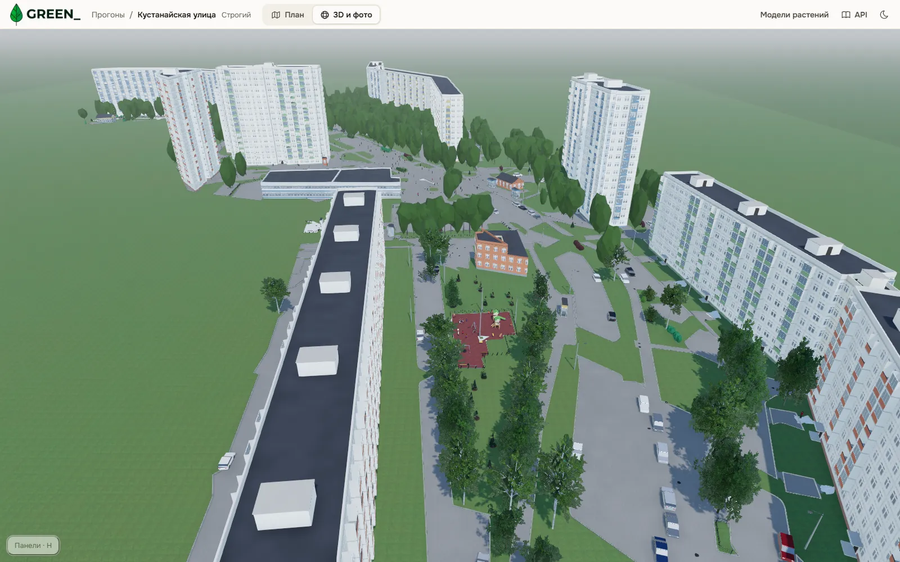
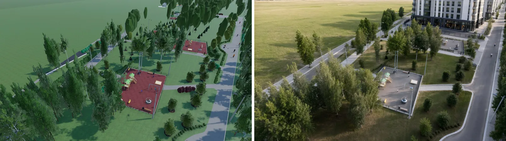

<p align="center">
  <picture>
    <source media="(prefers-color-scheme: dark)" srcset="frontend/public/logo-full-dark.webp">
    
  </picture>
</p>

<p align="center">
  Озеленение улиц по нормам. Кейс ДПиООС Москвы, Лидеры цифровой трансформации 2026.
</p>

**GREEN_** получает DXF участка (геоподоснова Мосгеотреста и подземные сети) и расставляет на
нём деревья и кустарник с нормативными отступами. Каждую посадку и каждый отказ сервис объясняет
пунктом акта: СП 42.13330, 743-ПП, 623-ПП (МГСН 1.02-02), 369-ПП. План ложится на отдельные слои
`GREEN_*` того же DXF, исходные слои остаются без изменений, и это проверяется после записи.

<p align="center">
  
</p>

## Запуск

```bash
git clone https://github.com/Mojarung/LCT_2026.git green && cd green
docker compose up --build -d
curl -s http://localhost:8000/api/v1/health      # {"status":"ok","version":"0.1.0"}
```

| Адрес | Что там |
|---|---|
| http://localhost:8000/ | веб-интерфейс: запуск, реестр прогонов, карта плана, объяснения, правка, 3D-вид |
| http://localhost:8000/docs | Swagger UI (статика из образа, без CDN) |
| http://localhost:8000/api/v1/ | HTTP API, схема OpenAPI 3.1 - [docs/openapi.json](docs/openapi.json) |

Свои данные не нужны: кнопка «Запустить на встроенном участке» (или
`curl -X POST http://localhost:8000/api/v1/runs/demo`) считает фрагмент улицы Берзарина:
окно 300 x 140 м настоящего чертежа пилота с сетями. Каталог 20 улиц пилота появляется в форме,
если в `./dataset/streets_oda` лежит подготовленный каталог (разд. 5.2 документации); без него
форма принимает любой свой DXF или DWG.

<details>
<summary><b>Полная версия: подсказки локальной LLM и фото ИИ на видеокарте</b></summary>

Обе части по желанию. Без них расчёт, DXF, объяснения и 3D-вид работают полностью.

**Подсказки LLM по именам слоёв.** Для слоёв, которые сервис понял только по геометрии,
модель Ollama предлагает класс на странице уточнения объектов. Это совет: план от него не
зависит. Профиль `llm` в `compose.yaml` поднимает Ollama 0.40.5 и при первом запуске скачивает
модель `gemma4:e4b-it-qat` (6,1 ГБ на диске, 3,3 ГБ памяти):

```bash
echo "GREEN_LLM_URL=http://ollama:11434" >> .env
docker compose --profile llm up -d --build
# Ollama на видеокарте NVIDIA (нужен NVIDIA Container Toolkit):
docker compose -f compose.yaml -f compose.gpu.yaml --profile llm up -d
```

**Фото по кадру 3D-вида.** Модель Qwen-Image-2.1-Turbo рисует фото участка по кадру 3D-вида на
видеокарте от 6 ГБ. Модели (около 14 ГБ вместе с Turbo) в образ не входят и сами не скачиваются:

```bash
uv run python tools/photos/fetch_models.py --dest /opt/green-models --platform linux
GREEN_PHOTO_MODELS_HOST=/opt/green-models \
  docker compose -f compose.yaml -f compose.photos.yaml up -d --build
```

`compose.photos.yaml` собирает образ `green-photos:latest` поверх `green:latest` (загрузчик
Vulkan и OpenMP) и подключает рантайм `nvidia`. Лицензия Qwen-Image-2.1 и 2.1-Turbo (Qwen
Research License) только некоммерческая.
Подробно - разд. 5.9 и 5.11 [документации](docs/documentation/05-run.md).

</details>

<details>
<summary><b>Без Docker: CLI и сервер на Python 3.14 через uv</b></summary>

```bash
uv sync
uv run green run путь/к/файлу.dxf --profile strict             # DXF или DWG
uv run green run генплан.dxf сети.dxf покрытия.dxf              # комплект склеивается в один чертёж
uv run green run улица.dxf --inventory перечётка.xls            # существующие деревья в квотах
uv run green run улица.dxf --layer охранные_зоны.geojson        # слой ГИС, можно несколько раз
uv run green run улица.dxf --set spacing_m=6 --set sp42_edition=2026
uv run green inspect улица.dxf                                  # слои и присвоенные им классы
uv run green verify вход.dxf out/<прогон>/result.dxf            # исходные сущности не изменены
uv run green audit план.dxf --plantings "^0?6_+ДП_.+_план$"     # нормоконтроль чужого плана
uv run green openapi --out docs/openapi.json                    # выгрузка схемы API
(cd frontend && npm ci && npm run build) && uv run green serve --port 8000
```

Результат `green run` - каталог `out/<run_id>/`, в stdout - JSON со сводкой, временем этапов и
путями файлов. Код выхода `green verify` и `green audit` - 1, если исходник изменён.

</details>

## Как это выглядит

<table>
  <tr>
    <td width="50%"></td>
    <td width="50%"></td>
  </tr>
  <tr>
    <td>Главная: улица пилота или свой чертёж, параметры профиля, реестр прогонов.</td>
    <td>Кустанайская улица целиком: 166 деревьев и 772 куста, проверки плана слева, состав по видам справа.</td>
  </tr>
  <tr>
    <td></td>
    <td></td>
  </tr>
  <tr>
    <td>3D-вид той же улицы: дома по этажности из подписей подосновы, посадки плана в возрасте 10 лет.</td>
    <td>Кадр 3D-вида Харьковской улицы и фото, которое по нему нарисовала Qwen-Image-2.1 (RTX 4080, 114 с).</td>
  </tr>
</table>

Снимки сделаны 20.10.2026 с сервиса в Docker, строгий профиль. Верхний снимок рабочего места -
клён Гиннала на Кустанайской: 2,48 м до силового кабеля при норме 2,00 м, 2,75 м до сети связи,
1,05 м до откоса, у каждой строки пункт СП 42.13330.2016 и `rule_id`.

## Что умеет

| Возможность | Как сделано |
|---|---|
| Нормы как данные | 104 правила в [`config/rules.yaml`](config/rules.yaml), из них 70 расстояний; акты - в [`config/acts.yaml`](config/acts.yaml). У правила стабильный `rule_id`, пункт и дословная цитата. Смена редакции акта - правка YAML, код не меняется |
| Объяснение каждого решения | посадка и отказ получают определяющую норму, измерение, запас в метрах, акт, пункт и цитату. Текст собирается из трассы правил, без языковой модели |
| Исходник не трогается | план только на слоях `GREEN_*`; после записи `result.dxf` перечитывается, отпечатки blake2b всех исходных сущностей сверяются (`green verify`, `verify.json`) |
| Независимая проверка плана | `validate_plan` заново меряет все расстояния для итоговых координат и видов; план с нарушением не выдаётся |
| Портфель вариантов | до 11 полных вариантов (жадный отбор, MILP, сетки по грунту и по бортам, группы); выигрывает лучший индекс качества среди прошедших проверку |
| Подбор вида | MILP (scipy, HiGHS) по условиям места и квотам разнообразия из каталога 58 видов: 33 дерева и 25 кустарников |
| Кустарниковый ярус и газоны | ряд у борта под кронами аллеи, живая изгородь, подлесок, группы на газоне, сохраняемый и устраиваемый газон, цветники |
| Правка в браузере | перенос, удаление и добавление посадки; сервис перемеряет нормы в новой точке и называет нарушенную; пересборка пишет правку в новый `result.dxf` на слой `GREEN_EDITS` |
| Уточнение распознавания | незнакомый слой или блок получает класс по словам имени и геометрии; страница «Объекты чертежа» показывает, что выведено догадкой, и пересчитывает с назначенными классами |
| 3D-вид (сверх ТЗ) и фото ИИ (бонус ТЗ) | сцена из тех же координат и видов: этажность домов, кроны по возрасту, сезоны, время суток, облёт; фото по кадру - Qwen-Image-2.1-Turbo локально |
| Нормоконтроль чужого плана | `green audit` проверяет посадки проектировщика теми же правилами: на Берзарина 391 посадка из 554 ближе нормы |
| Слои ГИС и кадастр | GeoJSON и SHP пересчитываются из WGS 84 в МСК-Москва: охранные зоны, здания, граница работ; участки кадастра задают тип территории, посадка на участке вне земель общего пользования требует согласования |
| Выход для проектировщика | ведомость по форме 9 ГОСТ 21.508-2020 в DXF, `workbook.xlsx`, пояснительная записка `note.docx` |
| Развёртывание | один образ Docker на Ubuntu 26.04, манифесты Kubernetes в [`deploy/k8s`](deploy/k8s), OpenAPI 3.1 и Swagger UI без сети |

Проверено на всех 20 улицах пилота: план есть на каждой, 4 871 дерево и 36 305 кустов, нарушений
норм по независимой проверке 0, сверено 9 001 171 исходная сущность, изменено 0. Время прогона
улицы - от 1,9 до 33 мин, медиана 9,1 мин (приложение B документации).

---

## Подробно

- [Как устроено](#как-устроено)
- [Почему так](#почему-так)
- [Конфигурация](#конфигурация)
- [API](#api)
- [Что на выходе](#что-на-выходе)
- [Требования ТЗ и как закрыты](#требования-тз-и-как-закрыты)
- [Тесты и проверки кода](#тесты-и-проверки-кода)
- [Ограничения](#ограничения)
- [Документация и презентация](#документация-и-презентация)
- [Структура репозитория](#структура-репозитория)

### Как устроено

Код - гексагональная архитектура в пакете [`src/green`](src/green). Зависимости идут только вниз,
это проверяет `import-linter` двумя контрактами в `pyproject.toml`.

| Слой | Что внутри |
|---|---|
| `interfaces` | CLI `green` (cyclopts), HTTP API `/api/v1` (FastAPI, ошибки по RFC 9457), раздача собранного React-интерфейса |
| `bootstrap` | `Settings` (переменные `GREEN_*`), сборка адаптеров в порты |
| `infrastructure` | чтение и запись DXF (ezdxf), REGION из ACIS, конвертеры DWG (ODA, LibreDWG), YAML норм и каталогов, слои ГИС (pyproj, pyshp), хранение прогонов, отчёты |
| `application` | сценарий `PlanSite`: классификация, карта покрытий, индекс ограничений, размещение, портфель, подбор вида, кустарник, проверка, индекс качества, объяснения, правка |
| `domain` | `Feature`, `DistanceRule`, `RuleBook`, `Placement`, `Rejection`, `Plan` - frozen dataclass без фреймворков |

Ядро (`application`, `domain`) не импортирует `ezdxf`, `fastapi`, `pydantic`, `yaml` и другие
библиотеки ввода-вывода. CLI, API и веб-интерфейс вызывают один и тот же сценарий.

Конвейер прогона:

| № | Этап | Что получается | Файл |
|---|---|---|---|
| 1 | конвертация DWG и сборка комплекта по внешним ссылкам | один DXF в метрах | `merged_source.dxf`, `assembly.json` |
| 2 | чтение без потерь: учёт каждого примитива, сверка «чернил» | сцена с погрешностью каждого объекта | `input_read.json` |
| 3 | классификация: условный знак, затем слой и блок, затем слова имени и геометрия; слои ГИС | класс каждого объекта с основанием | `classification.json`, `layers_report.json` |
| 4 | карта покрытий | где грунт, где твёрдое покрытие | `surface.json`, `surface.png` |
| 5 | индекс ограничений: STRtree по классам, векторная проверка правил | вердикт и трасса правил для любой точки | в памяти и в контексте правки |
| 6 | варианты плана: аллея вдоль борта, сетка по грунту, добор зоны; подбор вида; кустарник | посадки, отказы, зоны допустимости | `portfolio.json`, `selection.json`, `zones.geojson` |
| 7 | независимая проверка и выбор по индексу качества | прошедший проверку вариант | `validation.json`, `quality.json` |
| 8 | объяснения | текст каждой посадки и отказа | `interpretations.*`, `report.html` |
| 9 | запись DXF и сверка | `result.dxf`, слои `GREEN_*` | `verify.json`, `export_validation.json` |

BPMN-схемы прогона и правки - [`docs/documentation/diagrams/`](docs/documentation/diagrams/),
описание каждого этапа - [глава 3](docs/documentation/03-algorithm.md).

Веб-интерфейс - [`frontend/`](frontend/): React 19, TypeScript, Vite, Zustand, TanStack Query.
Карта плана рисуется на canvas без React, 3D-вид - на three.js. SPA ходит только в `/api/v1`, в
образ попадает собранный бандл, Node в итоговом образе нет.

### Почему так

Места выбирает алгоритм, а не обученная модель. Нормы - это пороги расстояний с пунктом акта,
выборки «хороших планов» для обучения нет, а планы проектировщиков сами нарушают нормы: у
Берзарина 391 посадка из 554 стоит ближе нормы. Языковая модель в сервисе только подсказывает
класс незнакомого слоя, и план от подсказки не зависит.

Нормы лежат в YAML, потому что редакции актов меняются. СП 42.13330 с 12.07.2026 действует в
редакции 2026 года, а ТЗ ссылается на 2016. У правила остаётся тот же `rule_id`, меняются пункт и
цитата; строки, где редакции разошлись, лежат рядом, и выбор между ними - параметр `sp42_edition`.

Генератор не проверяет сам себя. `validate_plan` заново меряет расстояния и не доверяет
сохранённым проверкам генератора, записанный DXF перечитывается и сверяется с планом и с
исходником, и экспорт идёт только после обеих сверок.

Догадка всегда видна. Нечитаемая геометрия останавливает расчёт с причиной; чертёж, прочитанный
не полностью, считается с предупреждением, а с `strict_input=true` останавливается. Класс,
выведенный по словам имени или по геометрии, помечается, и профиль `review` не считает план, пока
очередь уточнения не пуста.

Одинаковый вход, профиль и версия правил дают одинаковый план, пока не сработал лимит времени
(бюджет портфеля 900 с). Отпечатки конфигов, версии пакетов и время этапов пишутся в
`run_manifest.json`. Кустанайская в Docker на Linux дала тот же план, что на Windows.

### Конфигурация

Настройка идёт на трёх уровнях: переменные окружения сервиса, профиль прогона и параметры
поверх профиля. Нормы и каталоги - YAML в [`config/`](config/).

**Переменные окружения** читает `Settings` ([`src/green/bootstrap/settings.py`](src/green/bootstrap/settings.py)),
префикс `GREEN_`. Без Docker их можно положить в `.env` в корне репозитория, в Docker - в
`environment` сервиса `api` или в `compose.override.yaml`.

<details>
<summary>Все переменные <code>GREEN_*</code></summary>

| Переменная | По умолчанию | Зачем |
|---|---|---|
| `GREEN_CONFIG_DIR` | `config` (в образе `/app/config`) | каталог норм, актов, видов, профилей и словарей слоёв |
| `GREEN_RUNS_DIR` | `var/runs` (в образе `/data/runs`) | каталог прогонов: вход, артефакты, статус, контекст правки |
| `GREEN_STREETS_DIR` | `dataset/streets_oda` | каталог улиц пилота (`catalog.json`); нет каталога - список улиц пуст |
| `GREEN_WEB_DIR` | `frontend/dist` (в образе `/app/web`) | собранный веб-интерфейс |
| `GREEN_DEFAULT_PROFILE` | `strict` | профиль, если прогон его не назвал |
| `GREEN_CONVERTER` | `auto` | конвертер DWG: `auto`, `libredwg`, `oda`, `none` |
| `GREEN_LIBREDWG_BINARY` | `dwg2dxf` | путь к LibreDWG |
| `GREEN_ODA_BINARY` | `ODAFileConverter` | путь к ODA File Converter |
| `GREEN_CONVERTER_TIMEOUT_S` | `600` | предел конвертации одного файла, с |
| `GREEN_TEXT_FONT` | `DejaVuSans.ttf` | шрифт подписей результата |
| `GREEN_CORS_ORIGINS` | `[]` | разрешённые источники CORS, JSON-список |
| `GREEN_MAX_UPLOAD_MB` | `512` | предел загрузки, МБ |
| `GREEN_MAX_PARALLEL_RUNS` | `2` | сколько прогонов считается одновременно |
| `GREEN_RUNS_MAX_GB` | `20` (в `compose.yaml` 8) | предел каталога прогонов: старые законченные удаляются; 0 - без предела |
| `GREEN_EDIT_CONTEXTS` | `1` | сколько прогонов держать в памяти для правки |
| `GREEN_EDIT_CONTEXTS_SAVED` | `true` | хранить контекст правки на диске, чтобы правка пережила перезапуск |
| `GREEN_PHOTO_MODELS_DIR` | не задан | каталог моделей фото ИИ; не задан - кнопка фото недоступна |
| `GREEN_PHOTO_SD_BINARY`, `GREEN_PHOTO_ESRGAN_BINARY` | не заданы | свои пути к stable-diffusion.cpp и Real-ESRGAN |
| `GREEN_PHOTO_UPSCALER` | `4xNomos8kSC` | модель апскейлера |
| `GREEN_PHOTO_MAX_VRAM_GB` | `6` | потолок видеопамяти для фото |
| `GREEN_PHOTO_TIMEOUT_S` | `900` | предел одного фото, с |
| `GREEN_OSM_CONTEXT` | `auto` | город вокруг съёмки в 3D: `auto`, `tiles`, `online`, `off` |
| `GREEN_OSM_TILES_DIR` | `data/osm/moscow` | квадраты OpenStreetMap на диске (в образе `/app/data/osm/moscow`) |
| `GREEN_OSM_OVERPASS_URLS` | два сервера Overpass | запасной источник окружения, нужна сеть |
| `GREEN_OSM_TIMEOUT_S` | `90` | предел запроса Overpass, с |
| `GREEN_LLM_URL` | пусто | адрес Ollama для подсказок классов; пусто - подсказок нет |
| `GREEN_LLM_MODEL` | `gemma4:e4b-it-qat` | модель подсказок |
| `GREEN_LLM_TIMEOUT_S` | `180` | предел на все подсказки прогона, с |
| `GREEN_LOG_JSON` | `false` (в образе `true`) | журнал в JSON |
| `GREEN_LOG_LEVEL` | `INFO` | уровень журнала |

Только для `compose.photos.yaml`: `GREEN_PHOTO_MODELS_HOST` - каталог моделей на хосте, он
монтируется в контейнер как `/models`.

</details>

**Профили** - [`config/profiles/`](config/profiles/):

| Профиль | Для чего |
|---|---|
| `strict` | по умолчанию: шаг деревьев 5 м, отступ аллеи от борта 3; 2,5; 2 м |
| `barriers` | прикорневые барьеры (СП 42.13330.2016, табл. 9.1, прим. 5): дерево ближе нормы к сетям и борту с барьером как условием, шаг 6 м |
| `no_utilities` | съёмка без подземных сетей: посадки ставятся с вердиктом «требует согласования» |
| `review` | незнакомый DXF: без догадок о классах, расчёт идёт только после уточнения объектов |
| `shrubs` | рядовая посадка кустарника вдоль борта, шаг 1 м |

**Параметры поверх профиля.** В профиле 139 параметров. Любой меняется без правки кода:
`--set ключ=значение` в CLI, поле `overrides` (JSON) в API и раздел «Параметры» в форме запуска.
Переопределения записываются в `run_manifest.json`. Чаще всего нужны эти:

| Параметр | Что меняет |
|---|---|
| `spacing_m` | шаг деревьев, м (743-ПП, табл. 3.6.2) |
| `sp42_edition` | редакция СП 42.13330 для разошедшихся строк: `2016` или `2026` |
| `root_barriers` | допускать места с прикорневым барьером |
| `allow_needs_approval` | допускать посадки с вердиктом «требует согласования» |
| `modes` | приёмы по порядку: `existing_row`, `alley`, `lawn`, `fill` |
| `disabled_rules` | отключённые правила, они перечисляются в предупреждениях прогона |
| `strict_input` | останавливать расчёт, если чертёж прочитан не полностью |
| `portfolio_budget_s` | бюджет времени портфеля вариантов, с |

Все 139 с источниками - [приложение D](docs/documentation/generated/D-params.md).

**Нормы и каталоги** - YAML в [`config/`](config/):

| Файл | Содержание |
|---|---|
| `rules.yaml` | 104 правила: 70 расстояний, перечень и порядок по группам 369-ПП, видовые ограничения, газоны; у каждого акт, пункт, цитата, статус сверки |
| `acts.yaml` | акты: название, редакция, адрес текста, дата сверки |
| `species.yaml` | 58 видов: экология, размеры кроны, ограничения, источник каждого поля |
| `layer_map.yaml`, `symbols.yaml`, `vocabulary.yaml` | классы слоёв 20 улиц, словарь условных знаков, слова имён незнакомых слоёв и блоков |
| `geo_layers.yaml` | классы слоёв ГИС и система координат чертежа |

Чтобы сменить отступ или цитату без пересборки образа, копия `config/` монтируется в контейнер и
`GREEN_CONFIG_DIR` указывает на неё ([разд. 5.10](docs/documentation/05-run.md)). Правила,
профили и словари читаются заново к каждому прогону, каталог видов - при старте процесса.

### API

| Метод | Путь | Что делает |
|---|---|---|
| `POST` | `/api/v1/runs` | новый прогон: `file`, `profile`, `overrides`, файлы комплекта `extra`, ведомость `inventory`, слои ГИС `layers` |
| `POST` | `/api/v1/runs/demo` | прогон встроенного фрагмента Берзарина |
| `GET` | `/api/v1/runs`, `/api/v1/runs/{id}` | реестр и статус: этап, доля, оценка остатка, сводка |
| `GET` | `/api/v1/runs/{id}/artifacts/{name}` | любой файл выхода |
| `POST` | `/api/v1/runs/{id}/check`, `/edits`, `/rebuild` | проверка точки, правка плана, пересборка DXF |
| `POST` | `/api/v1/runs/{id}/review` | пересчёт с назначенными классами слоёв и объектов |
| `GET`, `POST` | `/api/v1/runs/{id}/photos` | фото ИИ по кадру 3D-вида |
| `GET` | `/api/v1/streets`, `/api/v1/meta`, `/api/v1/profiles/{name}` | каталог улиц, классы и параметры, профиль |

```bash
curl -s -F "file=@улица.dxf" -F "profile=strict" -F 'overrides={"spacing_m": 6}' \
     http://localhost:8000/api/v1/runs                       # 202 и id прогона
curl -s http://localhost:8000/api/v1/runs/<id>                # queued -> running -> succeeded
curl -s -o result.dxf http://localhost:8000/api/v1/runs/<id>/artifacts/result.dxf
```

Полное описание - [глава 7](docs/documentation/07-api.md) и Swagger на `/docs`.

### Что на выходе

Прогон пишет до 32 файлов в `runs/<id>/output/` (часть есть не всегда: `merged_source.dxf` -
только у комплекта). Главные:

| Файл | Что это |
|---|---|
| `result.dxf` | копия входа в его версии и единицах; план на слоях `GREEN_TREES`, `GREEN_SHRUBS`, `GREEN_LAWN`, `GREEN_FLOWERBED`, `GREEN_REJECT` и других; у посадки скрытые атрибуты `POS`, `NUM`, `SPECIES`, `NPA` (правило, акт, пункт); ведомость и легенда правил справа от плана |
| `result_layers.dxf` | только слои `GREEN_*` для наложения на свою подоснову |
| `report.html`, `interpretations.md` | отчёт: каждая посадка с определяющей нормой и запасом, каждый отказ с нарушенными нормами, цитаты актов |
| `interpretations.csv`, `interpretations.json` | строка на пару «решение - правило»: измерение, норма, акт, пункт, цитата, ссылка на объект чертежа |
| `plantings.csv` | строка на посадку: вид, координаты, вердикт, объяснение |
| `workbook.xlsx`, `note.docx`, `planting_schedule.csv` | ведомость, проверки числами, пояснительная записка с ведомостью по форме 9 |
| `verify.json`, `export_validation.json`, `validation.json` | целостность исходника, соответствие DXF плану, независимая проверка плана |
| `quality.json`, `portfolio.json` | индекс качества со слагаемыми и баланс «было - стало», варианты портфеля |
| `run_manifest.json` | вход (SHA-256), профиль, все параметры, отпечатки свода норм, версии библиотек, время этапов |

Полный перечень - [приложение C](docs/documentation/generated/C-artifacts.md). Готовый прогон
без запуска лежит в [`examples/berzarina-fragment/`](examples/README.md) вместе со снимками
`result.dxf` в LibreCAD 2.2 под Ubuntu 26.04.

### Требования ТЗ и как закрыты

| Требование | Как закрыто | Где проверить |
|---|---|---|
| DXF на входе, DXF на выходе, результат на отдельных слоях | слои `GREEN_*`, исходные сущности сверяются после записи | `green verify`, разд. 3.12 |
| Нормативные отступы от сетей, зданий, бортов | 70 правил расстояний, 9 классов сетей, измерение до наружной стенки по диаметру из подписи | разд. 3.6, прил. A |
| Объяснение каждой посадки и отказа пунктом акта | трасса правил, дословные цитаты, редакции СП 42 2016 и 2026 | `report.html`, `interpretations.*`, разд. 3.14 |
| Машиночитаемая выгрузка объяснений | JSON, CSV, Markdown, HTML, атрибут `NPA` в DXF | прил. C |
| Несколько типов посадок | аллеи, группы деревьев, изгороди, ряды и группы кустарника, подлесок, газоны, цветники | разд. 3.9, 3.17 |
| Параметризация и повторный прогон | 139 параметров, 5 профилей, `--set` и `overrides` | прил. D |
| Правки плана | перенос, удаление, добавление в браузере с проверкой норм и пересборкой DXF | разд. 3.15 |
| Docker, Kubernetes по желанию | многостадийный образ, `deploy/k8s` (проверен kubeconform) | разд. 2.4, 5.3 |
| OpenAPI / Swagger | OpenAPI 3.1, Swagger UI из образа | `/docs`, `docs/openapi.json` |
| Проверка DXF в CAD под Linux | LibreCAD 2.2 в контейнере `docker/cadcheck` | разд. 5.6 |
| Документация с BPMN | главы 00-08, схемы BPMN 2.0 | `docs/documentation/` |
| Бонус: визуализации | фото по кадру 3D-вида Qwen-Image-2.1-Turbo; сам 3D-вид из тех же координат и видов сделан сверх ТЗ | разд. 3.15, 5.9 |

### Тесты и проверки кода

Замер 20.10.2026 на Windows 11, Python 3.14, Node 24.16:

| Что | Тестов | Итог | Покрытие строк |
|---|---|---|---|
| Бэкенд, pytest: правила, чтение и запись DXF, геометрия, размещение, подбор, API, правка, отчёты, слои ГИС | 2 623 | 2 619 прошли, 4 пропущены | 95 % (19 354 строки `src/green`, не покрыто 926) |
| Фронтенд, vitest 5.0.1: карта, знаки видов, правка, 3D, снимки и фото, клиент API | 574 в 79 файлах | все прошли | 55 % (6 665 из 12 045 строк в файлах, которые загружают тесты) |
| `ruff check src`, `ruff format --check src` | | чисто (ruff 0.16.7) | |
| `ty check src` | | чисто (ty 0.0.81) | |
| `lint-imports` | 2 контракта | оба соблюдены | |

Пропущенные тесты ждут локальных данных, которых нет в репозитории: распакованного датасета,
чертежей других команд, текстов актов заказчика (`GREEN_LAWS_DIR`). Покрытие фронтенда считается
по файлам, которые импортирует хотя бы один тест (так vitest считает без `coverage.include`):
файл, который не загружает ни один тест, в знаменатель не попадает.

Повторить:

```bash
uv run pytest                                             # без замера покрытия
uv run --with pytest-cov pytest --cov=src/green --cov-report=term -q -p no:cacheprovider
uv run ruff check src && uv run ruff format --check src
uv run ty check src && uv run lint-imports
cd frontend && npm test
npm i --no-save @vitest/coverage-v8@5.0.1
npx vitest run --coverage --coverage.provider=v8 --coverage.reporter=text-summary
```

Реальные чертежи пилота проверяют инструменты, а не pytest: `tools/reader_check.py` читает все
улицы и сверяет учёт примитивов, `tools/street_runs.py --compare docs/data/street-golden.json`
прогоняет улицы и сверяет число посадок, отказов и площади с эталоном (допуск 5 %).
Сквозной сценарий в браузере - `npm run e2e` в `frontend/` (Playwright на живом сервере).

### Ограничения

Полный список - [глава 8](docs/documentation/08-limitations.md). Главное:

- DWG через LibreDWG теряет данные ACIS у каждой области REGION, и строгое чтение такой чертёж
  останавливает. Вход - DXF после ODA File Converter, или образ с `--build-arg WITH_ODA=true`.
- Газон, выведенный по подписи «ГАЗОН», имеет приблизительную границу: не дальше 30 м от
  подписи. Площадь такого газона показана отдельно.
- Функциональных зон улицы (остановки, входы, переходы) сервис не знает.
- Тип территории по 369-ПП и пол посадочного материала тополей из чертежа не определяются: это
  параметр профиля и допущение каталога.
- Нормы строже практики. У Берзарина 41,8 % деревьев проектировщика стоят ближе 2 м к силовому
  кабелю; без профиля `barriers` такие места уходят в отказы с объяснением, при каком барьере
  место допустимо.
- Прогон улицы занимает минуты, а не секунды: портфель считает несколько полных вариантов.
- Фото ИИ на видеокарте проверено на Windows с CUDA и в контейнере под Docker Desktop (WSL 2)
  сборкой stable-diffusion.cpp с CUDA: WSL 2 не даёт контейнеру Vulkan видеокарты. Путь Vulkan на
  Linux без WSL не проверялся. Kubernetes-манифесты в кластере не разворачивались.

### Документация и презентация

- [Техническая документация](docs/documentation/) по разд. 5 ТЗ, сборка в PDF -
  [green-documentation.pdf](docs/documentation/green-documentation.pdf): назначение и границы,
  архитектура и развёртывание, алгоритм и интерпретируемость с BPMN, методы и библиотеки,
  запуск и проверка, API, ограничения; приложения A-D - свод правил, итоги по улицам пилота,
  файлы прогона, параметры.
- Презентация в шаблоне ЛЦТ 2026 - [docs/green-lct2026.pdf](docs/green-lct2026.pdf).
- Анимированная схема конвейера - [docs/presentation.html](docs/presentation.html), её выгрузка
  [docs/presentation.pdf](docs/presentation.pdf).
- Сценарий демонстрации - [docs/demo.md](docs/demo.md).
- Требования к посадке по актам заказчика с цитатами -
  [docs/requirements/planting-requirements.md](docs/requirements/planting-requirements.md),
  база видов - [docs/species.md](docs/species.md).

### Структура репозитория

```
src/green/        пакет сервиса: domain, application, infrastructure, bootstrap, interfaces
frontend/         веб-интерфейс: React 19 + TypeScript + Vite, тесты vitest, e2e Playwright
config/           нормы, акты, виды, профили, словари слоёв, классы слоёв ГИС
tests/            тесты бэкенда (pytest)
docker/           Dockerfile сервиса, образ фото, образ проверки DXF в LibreCAD
deploy/k8s/       манифесты Kubernetes
examples/         пример входа и выхода, фото ИИ
tools/            подготовка каталога улиц, сквозной прогон улиц, сборка документации
docs/             документация, заметки, схема OpenAPI, презентация
```

Датасет пилота и тексты ТЗ в репозиторий не входят: `./dataset` монтируется в контейнер как
`/dataset` только для чтения.
