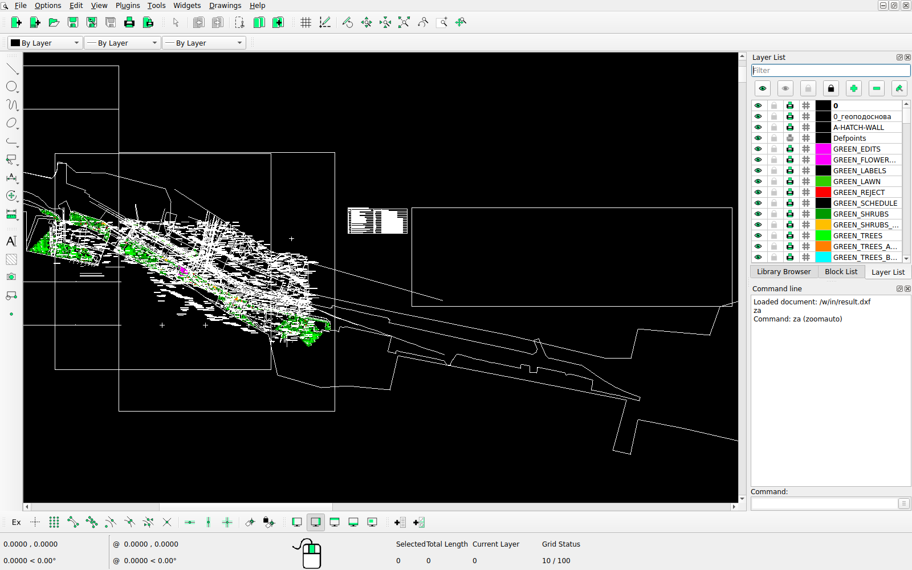
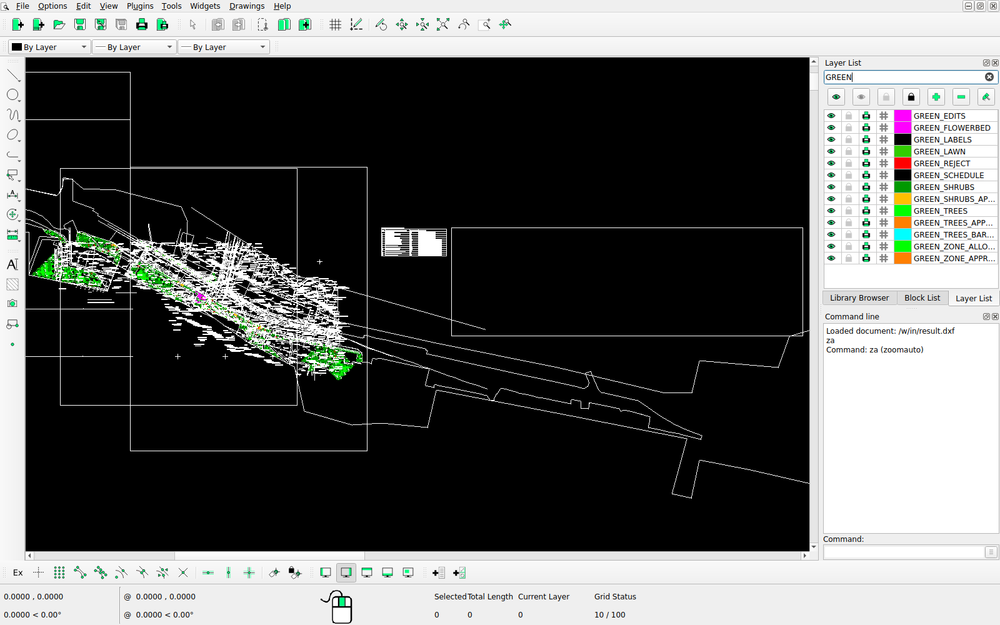
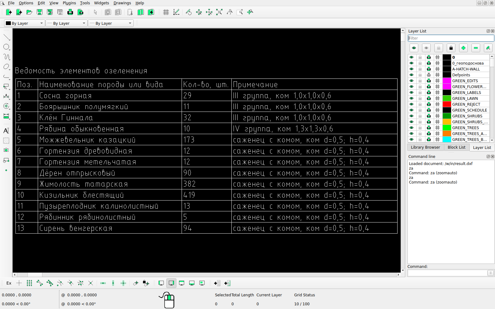

## 5. Сборка, запуск и проверка {#run}

Целевая среда - МосТех.ОС или иной Linux x86-64 с Docker. Интернет нужен для сборки образа;
расчёт плана в сеть не обращается (исключения по желанию - город вокруг участка в 3D-виде и
загрузка моделей, разд. 8.2).

### 5.1. Установка Docker

```bash
sudo apt-get update && sudo apt-get install -y docker.io docker-compose-v2 docker-buildx
sudo usermod -aG docker "$USER"          # затем выйти и войти в систему
docker version && docker compose version
```

### 5.2. Код и данные

```bash
git clone https://github.com/Mojarung/LCT_2026.git green && cd green
mkdir -p dataset                          # DXF и DWG для прогонов; в git датасет не входит
```

Каталог улиц пилота (по кнопке в интерфейсе) готовится из архива заказчика. Архив
кладётся в `dataset/Датасет/Пилотный проект 20 улиц.zip`, затем:

```bash
uv run python tools/prepare_streets.py --converter oda --out dataset/streets_oda
```

Команда выбирает файлы улицы по внешним ссылкам основного чертежа, конвертирует DWG через
ODA File Converter 27.1 и пишет `catalog.json`. В каталоге 20 улиц. У Фрунзенской набережной
в материалах нет ни одного DWG или DXF, только PDF-экспорты листов. Её генплан собирает
`tools/pdf_to_dxf.py`:
- слои чертежа сохранены в PDF как группы необязательного содержимого (OCG), они становятся
  слоями DXF;
- линии, кривые и невидимый текст SHX читаются в метрах при масштабе 1:500;
- штриховые линии AutoCAD выгружает в PDF отдельными штрихами, поэтому штрихи сшиваются
  обратно в линию: без этого граница работ (1 225 штрихов) не замыкалась;
- пять листов совмещаются по подписям линий совмещения «Лист N» и уточняются по вершинам
  линий: в перекрытии соседних листов совпало 98-99,6 % вершин ближе 5 см.

Не совместились листы - улица пропускается с причиной. У Нижних Полей основной чертёж без границы работ; она
добавлена отдельным файлом `granitsa-zakaza.dxf` - слой «Граница Заказа» из
`Исходные данные/АРхив/02_ГП - Standard.zip`, чертёж `02_ГП.dwg`. Без каталога сервис
принимает любой свой DXF.

### 5.3. Сборка и запуск

```bash
docker compose up --build -d              # образ green:latest, сервис api на порту 8000
docker compose logs -f api                # до строки о старте Granian
curl -s http://localhost:8000/api/v1/health
```

| Адрес | Что |
|---|---|
| `http://localhost:8000/` | веб-интерфейс: запуск, реестр прогонов, карта плана, объяснения, правка, 3D-вид |
| `http://localhost:8000/docs` | Swagger UI (статика из образа, без CDN) |
| `http://localhost:8000/api/v1/...` | HTTP API; схема - `docs/openapi.json` |

Сборка с ODA File Converter вместо LibreDWG для DWG (лицензия ODA принимается при сборке,
пакет скачивается с сайта ODA; в образе по умолчанию его нет):
`docker compose build --build-arg WITH_ODA=true`. В образе по умолчанию LibreDWG теряет
геометрию областей REGION: прогон идёт по прочитанному с заметкой «сущностей без данных», а в
строгом режиме (`strict_input=true`) останавливается на сверке записанного DXF («не сохраняются
N»). Без потерь DWG подаётся DXF после ODA File Converter 27.1 (разд. 8.2, п. 1).

Стенд с 16 ГБ памяти: `GREEN_MAX_PARALLEL_RUNS=1` в `compose.yaml` и `docker compose restart
api` между сериями тяжёлых улиц, когда ни один прогон не идёт (разд. 8.2, п. 9).

Kubernetes вместо Compose (по желанию): образ `green:latest` загружается в реестр или на
узлы кластера, затем `kubectl apply -k deploy/k8s` и
`kubectl -n green port-forward svc/green 8000:80`.

Стенд без сети: образ собирается там, где сеть есть, и переносится файлом.

```bash
docker save green:latest | gzip > green-image.tar.gz      # на машине сборки
docker load < green-image.tar.gz                           # на стенде
docker compose up -d                                       # без --build
```

### 5.4. Прогон DXF и получение результата

Через веб-интерфейс:

1. выбрать улицу пилота или свой чертёж;
2. при необходимости добавить под раскрытием «Параметры» остальные чертежи комплекта,
   перечётную ведомость, слои ГИС, параметры;
3. «Запустить прогон»;
4. на странице прогона - карта плана, состав и эффект плана (разд. 6.2);
5. «Скачать план DXF», остальное - кнопкой «Отчёты и другие файлы»: отчёт по посадкам, нормы
   CSV, пояснительная записка, отчёт распознавания, файлы расчёта.

Через API:

```bash
curl -s -F "file=@dataset/улица.dxf" -F "profile=strict" \
     -F 'overrides={"spacing_m": 6}' http://localhost:8000/api/v1/runs
# 202 и "id"; комплект - поле extra (повторяется), ведомость - inventory, слои ГИС - layers
curl -s http://localhost:8000/api/v1/runs/<id>            # state: queued -> running -> succeeded
curl -s -o result.dxf         http://localhost:8000/api/v1/runs/<id>/artifacts/result.dxf
curl -s -o interpretations.csv http://localhost:8000/api/v1/runs/<id>/artifacts/interpretations.csv
curl -s -o report.html        http://localhost:8000/api/v1/runs/<id>/artifacts/report.html
```

Командой в том же образе (вход из `./dataset`, результат в `./out`). Сервис в контейнере
работает от пользователя `green` (uid 10001), каталог результата должен быть ему доступен:

```bash
mkdir -p out && sudo chown 10001:10001 out
docker compose run --rm -v "$PWD/out:/out" api \
    green run "/dataset/улица.dxf" --profile strict --out /out/street
docker compose run --rm -v "$PWD/out:/out" api \
    green run "/dataset/улица.dxf" --layer "/dataset/охранные_зоны.geojson" \
    --set sp42_edition=2026 --out /out/street-2026
```

### 5.5. Проверка результата

1. **Сводка прогона** (`GET /runs/<id>`, поле `summary`): `integrity_ok: true`,
   `plan_valid: true`, `export_matches_plan: true`. Посадки, отказы, газоны, условия допуска.
2. **Исходник не изменён.** Команда перечитывает оба файла и сверяет отпечатки всех исходных
   сущностей. Для одиночного DXF исходником служит сам файл; для комплекта из нескольких
   чертежей - склеенный `merged_source.dxf` из каталога прогона, от него строится
   `result.dxf`; для одиночного DWG - DXF после конвертации (`converted/` в каталоге прогона):

   ```bash
   docker compose run --rm -v "$PWD/out:/out" api green verify "/dataset/улица.dxf" /out/street/result.dxf
   ```

   Сверку комплекта, посчитанного через API, повторяют по двум артефактам прогона:
   `merged_source.dxf` есть в списке `artifacts` только у комплекта (у одиночного файла
   исходник - сам входной файл, и ссылки нет). Ожидается `"ok": true` и пустые `changed`,
   `missing`, `added_outside_result_layers`:

   ```bash
   curl -s -o merged_source.dxf http://localhost:8000/api/v1/runs/<id>/artifacts/merged_source.dxf
   curl -s -o result.dxf        http://localhost:8000/api/v1/runs/<id>/artifacts/result.dxf
   docker compose run --rm -v "$PWD:/check" api green verify /check/merged_source.dxf /check/result.dxf
   ```

   Сверка того же `result.dxf` с одним генпланом комплекта не сходится: сети и остальные
   чертежи комплекта в результате есть, а в генплане их нет.

3. **Объяснения.** В `interpretations.csv` строка на пару «решение - правило», в
   `report.html` - отчёт с определяющей нормой каждой посадки. Для проектировщика есть
   ещё два файла. `workbook.xlsx` - ведомость, цветники и все проверки числами.
   `note.docx` - пояснительная записка: общие сведения, нормативная база, принятые решения,
   баланс «было - стало», ведомость по форме 9 ГОСТ 21.508-2020 и допущения прогона.

   Готовый пример без запуска лежит в `examples/berzarina-fragment/`: вход - встроенный
   фрагмент улицы Берзарина, выход - `result.dxf`, `report.html`, `interpretations.md`,
   `plantings.csv`, `verify.json` и остальные файлы прогона в образе с кодом сдачи
   (`examples/README.md`).
4. **Нормоконтроль чужого плана** теми же правилами:
   `green audit "/dataset/план.dxf" --plantings "<шаблон слоя посадок>" --out /out/audit`.

### 5.6. Проверка DXF в CAD под Linux

Выходной DXF открывается в nanoCAD, QCAD или LibreCAD. Исходные слои на месте, результат -
на слоях `GREEN_*` (разд. 3.12). Проверка без ручной установки CAD - контейнер
`docker/cadcheck` (Ubuntu 26.04, LibreCAD 2.2, Xvfb). Он открывает каждый DXF из входной
папки, вписывает вид по слоям `GREEN_*` и снимает экраны: результат поверх подосновы
(`<имя>.png`), только слои результата (`<имя>.green.png`), список слоёв с фильтром `GREEN`
(`<имя>.layers.png`) и ведомость крупно (`<имя>.schedule.png`). Версия LibreCAD, время
загрузки и ход проверки - в `cadcheck.log`:

```bash
docker build -t green-cadcheck docker/cadcheck
mkdir -p out/cadcheck-in out/cadcheck && cp out/street/result.dxf out/cadcheck-in/
docker run --rm -v "$PWD/out/cadcheck-in:/w/in" -v "$PWD/out/cadcheck:/w/out" green-cadcheck
```

Вид вписывается по результату, а не по всему чертежу: подоснова бывает в разы шире плана (у
фрагмента Берзарина линия границы заказа тянется на 2,9 км при плане 0,4 км), и после «вписать
всё» (`za`) план сжимается в полоску. Окно зума LibreCAD координат из строки команд не
принимает, а `za` вписывает только видимые слои. Поэтому скрипт скрывает все слои, включает
`GREEN_*`, делает `za` и снова включает все слои: вид остаётся на результате. Чертёж без слоёв
`GREEN_*` (исходник) вписывается целиком. LibreCAD каждый раз стартует с чистыми настройками
и разворачивается на весь экран 1600 x 1000, поэтому строка команд и список слоёв стоят на
известных местах.

Проверка 20.10.2026: LibreCAD 2.2.0.2 под Ubuntu 26.04.1 (контейнер `docker/cadcheck`),
`result.dxf` встроенного фрагмента Берзарина строгого профиля из образа сдачи (8 МБ,
открылся за 8 с; тот же файл лежит в `examples/berzarina-fragment/`): 1282 посадки, из них
82 дерева и 1200 кустов, 16 газонов и цветник. Что видно на снимках:
- все {{result_layers}} слоёв `GREEN_*`, включая `GREEN_LAWN`, `GREEN_FLOWERBED` и
  `GREEN_EDITS`, стоят в списке рядом с исходными и включаются отдельно;
- план виден целиком поверх подосновы, ведомость и легенда стоят справа от плана; легенду
  правил (один многострочный текст) LibreCAD на общем виде рисует пустой рамкой (разд. 8.3);
- русские слова ведомости читаются (рис. 5.3);
- LibreCAD не выбросил при открытии ни одного объекта. Прошлый узор цветника STARS он
  выбрасывал: в его наборе узоров STARS нет. Тест держит узоры результата в наборе LibreCAD.

Проверка 29.09.2026 тем же контейнером: Кустанайская улица (33 МБ) открылась за 397 с, число
посадок в ведомости сошлось со слоями. Снимки лежат в `examples/berzarina-fragment/cad/`.

<figure class="wide"><figcaption>Рис. 5.1. Фрагмент улицы Берзарина в LibreCAD 2.2 под Linux: вид вписан по слоям GREEN_*, включены все слои. Посадки (зелёным), отказы (красным) и цветник (лиловым) лежат поверх подосновы; правее плана - ведомость и легенда.</figcaption></figure>

<figure class="wide"><figcaption>Рис. 5.2. Тот же чертёж, список слоёв: слои результата GREEN_* отдельно от исходных, каждый включается и выключается сам по себе.</figcaption></figure>

<figure class="wide"><figcaption>Рис. 5.3. Ведомость элементов озеленения крупно: позиции, названия пород и видов по-русски, количества и стандарт посадочного материала читаются.</figcaption></figure>

Особенности LibreCAD:

- подписи результата написаны стилем `unicode`: так LibreCAD берёт свой штриховой шрифт
  `unicode.lff` с кириллицей, а AutoCAD и nanoCAD - TrueType-файл стиля. Подписи подосновы
  со стилем `standard` LibreCAD рисует без кириллицы: в его шрифте `standard`
  русских букв нет;
- атрибуты вставок LibreCAD не рисует, поэтому номер позиции ведомости у каждой посадки
  записан ещё и обычным текстом на слое `GREEN_LABELS` (атрибут `POS` скрыт, чтобы nanoCAD не
  показал номер дважды): на крупном виде цифры у посадок читаются
  (`examples/berzarina-fragment/cad/librecad-positions.png`); на общем виде рис. 5.1 они слишком
  мелкие;
- при ручном открытии вид стоит у начала координат: нужен «вписать» (`za`), а чтобы план не
  сжался в полоску - сначала скрыть исходные слои;
- большой чертёж открывается минутами: Кустанайская (33 МБ) - 6,6 мин. Для полного генплана
  лучше nanoCAD или QCAD.

### 5.7. Запуск без Docker (разработка)

```bash
uv sync                                   # Python 3.14 и зависимости строго по uv.lock
cd frontend && npm ci && npm run build && cd ..
uv run green serve --port 8000            # интерфейс из frontend/dist, Swagger на /docs
uv run green run dataset/улица.dxf --profile strict
```

### 5.8. Тесты и проверки кода

| Команда | Что проверяет | Итог |
|---|---|---|
| `uv run pytest` | бэкенд: правила, чтение, геометрия, размещение, подбор, API, правка, отчёты, слои ГИС | 20.10.2026: 2623 теста, 2619 прошли, 4 пропускаются без локальных данных; покрытие строк `src/green` 95 % (pytest-cov), 46 мин |
| `npm test` в `frontend/` | интерфейс: карта, знаки видов, правка, 3D, снимки и фото, клиент API | 20.10.2026: 1082 теста, все прошли; покрытие строк `src/` 96,4 % (`npm run test:coverage`) |
| `npm run e2e` в `frontend/` | сквозной сценарий в браузере на живом сервере: прогон, правка, пересборка, DXF, 3D-снимок | проходит за 6,1 мин |
| `uv run ruff check src`, `uv run ty check src`, `uv run lint-imports` | стиль, типы, контракты слоёв | чисто |

### 5.9. Фото по кадру 3D-вида (бонус, по желанию) {#photos}

Фото рисует модель Qwen-Image-2.1 на видеокарте машины, где запущен сервис. В Docker-образ
модели и программы не входят и при запуске не скачиваются. Без них расчёт, DXF, объяснения и
3D-вид работают полностью, а кнопка «Фото ИИ» в 3D-виде показывает причину: «Генерация фото на
сервере не настроена».

Нужны видеокарта от 6 ГБ (CUDA 12 на Windows, Vulkan на Linux), 16 ГБ ОЗУ и 11 ГБ на диске.

```bash
sudo apt-get install -y libvulkan1 libgomp1   # Linux: загрузчик Vulkan и OpenMP для программ
uv run python tools/photos/fetch_models.py --dest ~/green-models --platform linux
GREEN_PHOTO_MODELS_DIR=~/green-models uv run green serve --port 8000
```

Скрипт кладёт в каталог модели (Qwen-Image-2.1 и 2.1-Turbo Q4_K_S, VAE, кодировщик Qwen3-VL-8B
IQ4_XS с mmproj), stable-diffusion.cpp и Real-ESRGAN с моделью 4xNomos8kSC в той раскладке, где их ищет
сервис. Прерванную загрузку можно повторить: скачанные файлы пропускаются. `--check` только
проверяет ссылки. Потолок видеопамяти - `GREEN_PHOTO_MAX_VRAM_GB` (6 по умолчанию). Кадр
1024×576 рисуется за 75-115 с на RTX 5070, апскейл ×4 - ещё около 8 с. Кадр 1536×864 на
RTX 4080 с апскейлом до 3840×2160 - 114-169 с. Примеры кадров и фото Харьковской улицы -
`examples/photos/` (20.10.2026, всё локально, без сети).

Если в каталоге моделей лежит файл `qwen-image-2.1-turbo-Q4_K_S.gguf` (Qwen-Image-2.1-Turbo,
GGUF от unsloth), сервис берёт его вместо 2.1: 8 шагов с расписанием чекпойнта и CFG 2 вместо
25 шагов с CFG 4, VAE и кодировщик те же (`infrastructure/photo/sdcpp.py`). Скрипт
`fetch_models.py` скачивает его вместе с остальными моделями (ещё 3,7 ГБ). Замер 17.10.2026 на
RTX 5070: кадр 1024×576 - 43-45 с вместо 70-96 с у 2.1, 1536×864 - 84-85 с, видеопамять
6,5-6,7 ГБ; расстановку посадок Turbo держит точнее (`docs/notes/40-scene-photos.md`).

Фото на видеокарте проверено на Windows с CUDA. Под Linux скрипт проверен в Ubuntu 26.04:
программы легли в нужную раскладку и запускаются (`sd-cli --help`,
`realesrgan-ncnn-vulkan -h`). 20.10.2026 кадр 1536×864 сгенерирован на RTX 5070 в контейнере
`compose.photos.yaml` под Docker Desktop (WSL 2), но сборкой stable-diffusion.cpp с CUDA в
`bin/sd-cuda`: WSL 2 передаёт контейнеру только CUDA, без Vulkan видеокарты, и сборка Vulkan
из скрипта считает там на процессоре. Путь Vulkan на Linux без WSL не проверялся.

Лицензия Qwen-Image-2.1 и Qwen-Image-2.1-Turbo - Qwen Research License: только
некоммерческое использование (исследования и оценка). Для работы в контуре департамента нужна коммерческая лицензия
правообладателя или другая модель (разд. 8.2).

### 5.10. Обновление норм без пересборки образа {#config-mount}

Нормы, акты, виды, профили и словари слоёв лежат в образе в `/app/config`, путь к ним задаёт
переменная `GREEN_CONFIG_DIR`. Чтобы сменить редакцию акта, цитату или отступ, добавить слово
в словарь слоёв или свой профиль, образ пересобирать не нужно: копия каталога `config/`
монтируется в контейнер, и `GREEN_CONFIG_DIR` указывает на неё.

```bash
cp -r config config-local        # копию правят: rules.yaml, acts.yaml, profiles/, vocabulary.yaml
```

Файл `compose.override.yaml` рядом с `compose.yaml` (Compose подхватывает его сам):

```yaml
services:
  api:
    environment:
      GREEN_CONFIG_DIR: /config
    volumes:
      - ./config-local:/config:ro
```

```bash
docker compose up -d             # контейнер пересоздаётся с каталогом норм, без --build
docker compose restart api       # после следующих правок config-local
```

Правила, акты, словари слоёв и профили читаются заново к каждому прогону, каталог видов - при
старте процесса: после правки `species.yaml` нужен `restart`. Перезапуск прерывает идущий
прогон (разд. 8.3), поэтому его делают между прогонами. Каталог должен быть полным: копия
`config/` той же версии сервиса, а не отдельные файлы. Ошибка в YAML останавливает прогон с
именем файла и поля. Отпечатки свода правил и карты слоёв пишутся в `run_manifest.json`
(`fingerprints`, параметры профиля - в `params`), отпечаток свода - и в шапку
`interpretations.md`: по ним видно, по какой версии норм посчитан план.

При смене редакции акта `rule_id` правила остаётся прежним, меняются пункт, цитата и дата
сверки. Если новая редакция меняет значение, в свод добавляется правило новой редакции, а
выбор редакции становится параметром, как для СП 42.13330.2026 (`sp42_edition`, разд. 3.14.4).
Проверено 29.09.2026 на образе `green:latest`: без переменной сервис читает `/app/config`
(`R-CURB-TREE-001` - 2,0 м), с `GREEN_CONFIG_DIR=/config` и смонтированной копией, где у этого
правила 2,7 м, - копию (2,7 м).

### 5.11. Подсказки локальной языковой модели (по желанию) {#llm-hints}

Для имён слоёв, которые сервис понял только по геометрии, локальная модель предлагает класс на
странице уточнения (разд. 3.4): строка «Модель X предлагает: класс» и кнопка «Принять подсказку».
Это только совет: класс объекта и план от него не зависят, без модели сервис работает так же.
Свою Ollama поднимает профиль `llm` в `compose.yaml`:

```bash
echo "GREEN_LLM_URL=http://ollama:11434" >> .env
docker compose --profile llm up -d --build
docker compose logs -f ollama-pull   # первый запуск: загрузка модели 6,1 ГБ, нужен интернет
```

Модель по умолчанию - `gemma4:e4b-it-qat`: 3,3 ГБ памяти, укладывается в видеокарту стенда от
4 ГБ; выбрана из 24 локальных моделей по отложенным именам слоёв пилота. Диск: образ Ollama
3,8 ГБ и модель 6,1 ГБ (том `ollama`). В контейнере модель считает процессор: подсказки для
десятков имён занимают минуты, прогон ждёт все подсказки не дольше `GREEN_LLM_TIMEOUT_S` (180 с;
что не успели спросить, остаётся без подсказки), этап идёт после подосновы, и карта модель не
ждёт. Сбой модели - строка в журнале прогона, а не остановка. Видеокарта NVIDIA (NVIDIA Container
Toolkit) подключается файлом `compose.gpu.yaml`:
`docker compose -f compose.yaml -f compose.gpu.yaml --profile llm up -d`. Другая модель - переменная `GREEN_LLM_MODEL`,
её же загрузит `ollama-pull`; Ollama на самой машине - `GREEN_LLM_URL=http://host.docker.internal:11434`.

### 5.12. Проверка за 15 минут {#quick-check}

Маршрут для проверяющего, который видит сервис впервые. Время на шаг ориентировочное,
образ уже собран и запущен (разд. 5.3).

1. **Сервис жив (1 мин).** `curl -s http://localhost:8000/api/v1/health` отвечает JSON с
   версией, `http://localhost:8000/docs` открывает Swagger.
2. **Прогон без своих данных (3 мин).** На стенде без каталога улиц форма предлагает
   «Встроенный участок улицы Берзарина» и кнопку «Запустить на встроенном участке»; то же
   делает `curl -s -X POST http://localhost:8000/api/v1/runs/demo`. Прогон появляется в
   реестре, его статус - `GET /api/v1/runs/{id}`.
3. **План на карте (2 мин).** На странице прогона видно:
    - деревья и кустарник со своими знаками;
    - отказы красными крестами;
    - газоны и цветники отдельными слоями легенды.

   Щелчок по посадке открывает определяющую норму с пунктом акта и запасом в метрах.
4. **DXF (4 мин).** Скачать `result.dxf` и открыть в nanoCAD, QCAD или LibreCAD. Слои
   `GREEN_*` стоят рядом с исходными и выключаются отдельно. `verify.json` и `green verify`
   подтверждают, что исходные слои не изменены (разд. 5.5).
5. **Объяснения (3 мин).** Объяснения лежат в трёх файлах:
    - `report.html` - определяющая норма каждой посадки и причина каждого отказа;
    - `interpretations.csv` - строка на пару «решение - правило»;
    - `note.docx` - пояснительная записка с ведомостью по форме 9.

   Пункты актов сверены с текстом: цитаты лежат в `config/rules.yaml`.
6. **Правка (2 мин).** Перетащить посадку к сети: сервис перемеряет нормы в новой точке и
   назовёт нарушенную, если она есть. После пересборки правка попадает в новый `result.dxf`
   на слой `GREEN_EDITS`.

Воспроизводимость на 20 улицах пилота проверяет `tools/street_runs.py` (нужен каталог улиц,
разд. 5.2). Число посадок, отказов, площадь газонов и цветников сверяются с эталоном
`docs/data/street-golden.json` с допуском 5 %. Целостность исходных слоёв, независимая
проверка плана и сверка экспорта сверяются точно:

```bash
uv run python tools/street_runs.py --workers 3 --compare docs/data/street-golden.json
```

Расхождение печатается строкой «ДРЕЙФ улица: поле было -> стало», код выхода 1.
